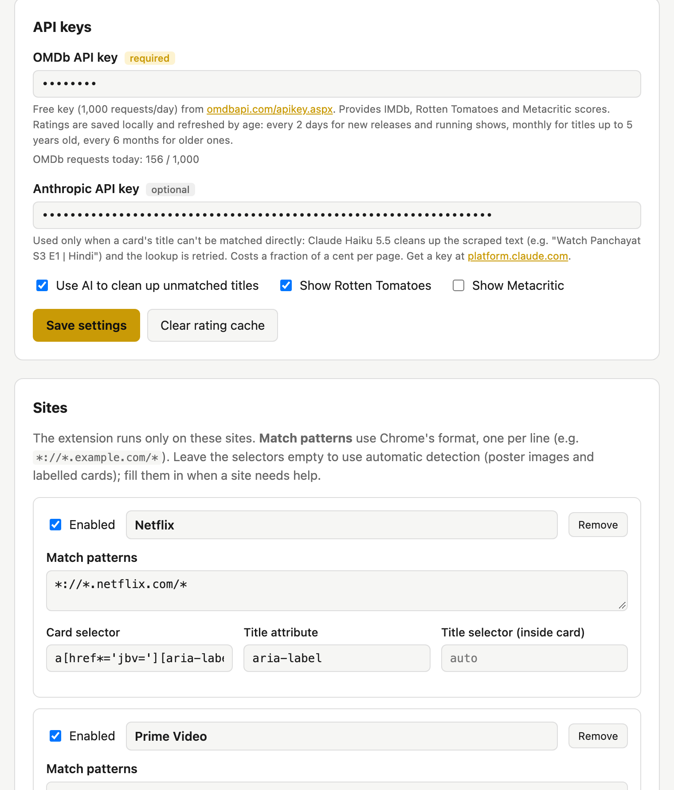

<p align="center">
  
</p>

<h1 align="center">Reelscore</h1>

<p align="center">IMDb and Rotten Tomatoes ratings right on the posters of Netflix, Prime Video, Hotstar, and any streaming site you add.</p>

---

Picking something to watch usually means opening a new tab and searching every title on IMDb. Reelscore is a Chrome extension that does it for you. It puts a small badge on each movie and show card as you browse:

```
┌──────────────────────┐
│ IMDb 8.1  🍅 93%     │  ← hover for the matched title, year, genre and votes
│                      │    click to open the IMDb page
│      (poster)        │
│                      │
└──────────────────────┘
```

- **Works out of the box** on Netflix, Prime Video (primevideo.com and amazon.com / .in / .co.uk `/gp/video`) and Hotstar / JioHotstar.
- **Add any site** in two clicks from the toolbar popup.
- **Uses few requests.** Ratings are cached and refreshed by how old the title is, so scrolling the same rows again costs nothing.
- **Stays out of the way.** Badges hide while a video plays or is full screen, and skip things that aren't movies or shows (language tiles, live channels, sports clips).
- **Optional AI cleanup.** Titles OMDb can't match ("Stranger Things: Season 4 – Official") can be sent to Claude Haiku, which returns the real title.

## Setup (about 5 minutes)

Reelscore isn't on the Chrome Web Store yet, so you load it as an unpacked extension.

### 1. Get the code

```bash
git clone https://github.com/nitinhayaran/reelscore.git
```

Or click **Code → Download ZIP** on this page and unzip it.

### 2. Get a free OMDb API key (required)

Ratings come from [OMDb](https://www.omdbapi.com/).

1. Go to <https://www.omdbapi.com/apikey.aspx>, choose **FREE** (1,000 requests a day), and enter your email.
2. OMDb emails you the key and an **activation link**. Click the link, or the key won't work.

### 3. Load the extension in Chrome

1. Open `chrome://extensions`.
2. Turn on **Developer mode** (top right).
3. Click **Load unpacked** and select the `reelscore` folder (the one with `manifest.json` in it).
4. Optional: click the puzzle-piece icon in the toolbar and pin Reelscore.

The settings page opens on its own.

### 4. Add your key

Paste the OMDb key and click **Save settings**. Then open (or reload) Netflix, Prime Video or Hotstar. Badges appear as cards scroll into view.

<p align="center">
  
</p>

### 5. Optional: turn on AI title cleanup

Some sites show titles OMDb can't match directly: extra words, regional names, odd punctuation. With an [Anthropic API key](https://console.anthropic.com/settings/keys), those titles go to Claude Haiku 5.5, which returns the official IMDb title and year. It is also told to say when something isn't a movie or show, such as a live channel or a cricket match.

- Paste the key under **Anthropic API key** in settings and keep **Use AI** ticked.
- Each title that needs it is sent once, then cached. Typical use costs a few cents a month.
- Without a key, everything else still works. Unmatched titles just show no badge.

## Using it

| Want to… | Do this |
|---|---|
| Turn it off on one site | Click the toolbar icon → **Turn off for this site** |
| Add another streaming site | Open the site, click the toolbar icon → **Add &lt;site&gt;**, and allow access |
| Check a match is right | Hover the badge to see the title, year, genre and vote count it found |
| Open the IMDb page | Click the badge |
| Show Metacritic too | Settings → tick **Show Metacritic** |
| See how many OMDb requests you've used today | Settings, under the API keys |
| Force fresh ratings | Settings → **Clear cache** |

Badge colours: **gold** is 7.5 or higher, **amber** is 6.0 to 7.4, **grey** is below 6.0.

## How it works

```
page cards ──► content script ──► background worker ──► OMDb (IMDb / RT / Metacritic)
                (finds titles)        │   cache, refreshed by title age
                                      └─► Claude Haiku 5.5, only for titles OMDb couldn't match
```

1. **Find cards.** On each enabled site, the content script finds movie and show cards. It uses the site's **card selector** if one is set (Netflix and Prime Video have one). Otherwise it uses **generic detection**: elements with `data-card-title`, labelled links around a poster, and poster-sized images with alt text. Hotstar uses generic detection.
2. **Read the title** from `data-card-title`, `aria-label`, `title`, or the image's `alt`. Then strip UI noise: "Go to", "Watch", "- Season 2", "S3 E1". A "(2019)" becomes the year, and "Billions, Show" becomes a series hint.
3. **Look it up** in batches, only when a card scrolls near the screen. OMDb's free key allows 1,000 *requests* a day, and repeats count. So ratings are saved locally and refreshed by the title's age:

   | Title | Refreshed after |
   |---|---|
   | Released this year or last, still-airing series, unknown year | 2 days |
   | Up to 5 years old | 30 days |
   | Older | 180 days |
   | Not found on OMDb | 3 days |

   Saved ratings are never deleted. If the daily limit is hit or OMDb is down, Reelscore pauses OMDb for an hour and keeps showing saved ratings, even ones past their refresh date.
4. **AI fallback.** Titles that missed go to Claude in one batched call, then the lookup is retried. Direct matches are shown first, so the AI step never slows down the badges that already worked.
5. **Badge.** A small pill in the card's top-left corner. Clicks on it don't open the card underneath.

## Adding a site

**Quickest:** open the site, click the Reelscore toolbar icon, then **Add &lt;site&gt;**. Chrome asks for access to that site, and Reelscore starts right away with generic detection.

**From settings:** click **+ Add site**, give it a name and match patterns (`*://*.example.com/*`, one per line), then **Save sites**.

If generic detection misses cards or badges the wrong things, set selectors for the site in settings:

| Field | Meaning | Example |
|---|---|---|
| Card selector | CSS selector matching one card | `article[data-card-title]` |
| Title attribute | Attribute holding the title, on the card or the title element | `aria-label` |
| Title selector | Element inside the card that holds the title (text or the attribute above) | `.card-title` |

To find these, right-click a card → **Inspect**, and look for an attribute that holds the title.

To ship a site as a built-in default for everyone, add it to `DEFAULT_SITES` in [`src/config.js`](src/config.js) and its domain to `host_permissions` in [`manifest.json`](manifest.json).

## Privacy

- Reelscore has no server and no analytics.
- Sent to **OMDb**: the card titles (and year or type when known), with your OMDb key.
- Sent to **Anthropic**, only with AI cleanup on: titles OMDb couldn't match, the site name, and short nearby text such as the row heading.
- Your API keys are kept in Chrome's synced extension storage, on your own Chrome profile. Ratings are cached in local extension storage.
- The extension reads streaming pages only to find titles. It doesn't read your account, history or anything else.

## Troubleshooting

| Problem | Fix |
|---|---|
| No badges at all | Check the OMDb key is saved and activated (the email link). Reload the streaming tab after installing or updating. Make sure the site is on in the toolbar popup. |
| "Invalid OMDb API key" toast | You haven't clicked the activation link in OMDb's email yet, or the key has a typo. |
| Badges stopped after the site changed its layout | In settings, clear that site's card selector to fall back to generic detection, or update the selector. Please also open an issue. |
| Wrong movie matched | Same-name titles without a year can mix up (e.g. a series and an old film). Hover the badge to check. AI cleanup helps here. |
| A show has an IMDb score but no 🍅 | OMDb mostly has Rotten Tomatoes scores for movies, not TV. |
| "Daily limit reached" notice | You've used 1,000 OMDb requests today. Saved ratings keep showing, and new ones resume later. |

## Project layout

Plain JavaScript, Manifest V3, no build step. Edit a file and click reload on `chrome://extensions`.

| Path | Role |
|---|---|
| `manifest.json` | MV3 manifest. Default sites are pre-granted; added sites request access when saved. |
| `src/config.js` | Default site list and settings, match-pattern helpers |
| `src/background.js` | Service worker: registers the content script on enabled sites, handles rating requests |
| `src/ratings.js` | OMDb lookups, cache, request throttling |
| `src/llm.js` | Title cleanup with Claude Haiku 5.5 (swap in another provider here) |
| `src/content.js`, `src/content.css` | Card detection, title extraction, badges |
| `options/` | Settings page: API keys, site list |
| `popup/` | Toolbar popup: on/off for the current site, add the current site |
| `icons/` | Icons. `icon.svg` is the source for every PNG size |

## Contributing

Streaming sites change their markup often, so selector fixes and new site defaults are the most useful contributions. Open an issue with the site and a screenshot, or send a pull request.

## License

[MIT](LICENSE). Not affiliated with IMDb, Rotten Tomatoes, OMDb, or any streaming service.
